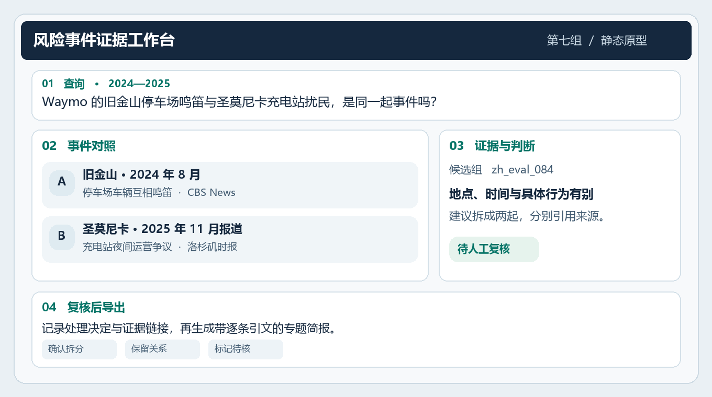

# 第七组 · AI 风险知识图谱与洞察

**文本挖掘与自然语言处理｜课程项目第一阶段**

李陶睿越、李芸韬、尹志轩、李硕

## 面向 AI 风险事件的可追溯报告生成

我们研究事件图谱对证据核查的影响。RiskNet 的同一评测候选组包含两起独立的 Waymo 事件。如果系统把整个候选组直接算成一起，就会漏计一起。我们比较普通检索、图谱辅助检索与增加冲突校验的图谱方案。

- [第一阶段报告 · Markdown](risknet-phase1.md)
- [第一阶段报告 · PDF](group07-risknet-phase1.pdf)

图中是基于真实材料拟定的期望输出。

## 带出处的报告样例

**示例输出（人工编写）。** 旧金山，2024 年 8 月，Waymo 车辆在停车场相互鸣笛。[CBS News](https://www.cbsnews.com/news/waymos-driverless-cars-honking-san-francisco/)

圣莫尼卡，2025 年 11 月，市议会要求两处充电站停止夜间运营。[《洛杉矶时报》](https://www.latimes.com/california/story/2025-11-24/santa-monica-orders-waymo-to-stop-noisy-overnight-operations-at-charging-stations-neighbors-rejoice)

**计数判断。** 两起事件的时间、地点和具体行为有别，应分别计数。
