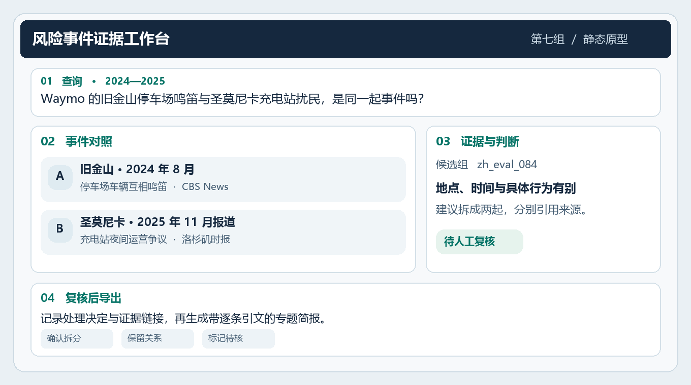

# 面向 AI 风险事件的可追溯报告生成

**事件图谱对证据核查的影响**

文本挖掘与自然语言处理 · 课程项目第一阶段报告  
**第七组** · 李陶睿越、李芸韬、尹志轩、李硕  
选题方向｜AI 风险知识图谱与洞察 · 2026 年 11 月 5 日

## 01 选题与目标

**目标用户与场景。** 面向需要从多篇报道整理 AI 风险专题的课程研究者。以自动驾驶车辆对社区的影响为首个专题，输入问题和范围，系统返回去重后的事件、逐条结论、出处及待核查项。研究者可回到原始来源，复核计数、拆分误合并的事件，再导出简报。

**研究问题。** 在固定语料、模型与上下文预算的条件下，事件图谱能否改善跨报道去重和结论的证据支持？如果候选组包含不同事件，系统直接把候选关系当成事件归属会怎样影响计数？时间、地点和行为校验能否减少误合并？

**范围与交付。** 首个演示专题为自动驾驶车辆对社区的影响。DeepSeek 是跨场景的普通核查样例，正式评测可纳入其他 AI 风险场景。最终原型包括事件图谱、报告 Agent、情境卡、样本范围内的风险分布及典型模式。风险分布按核验后的事件计数，标明覆盖范围和未知项。模式线索来自场景、触发因素与影响的共现，再以支持案例和反例复核。本阶段交付方案、静态原型、样例及初步数据核验。

## 02 相关调研

| 工作 | 借鉴与项目切入点 |
|---|---|
| [RiskNet V1.0](https://zenodo.org/records/22093475) 与[课程项目说明](https://github.com/zhangleihan/ai-risk-knowledge-graph/blob/main/docs/PROJECT_BRIEF.md) | 利用报道与事件关联及多维标签启动图谱。将已有分组当作候选关系，单独记录人工核验。 |
| [Han 等，RAG vs. GraphRAG](https://arxiv.org/abs/2502.11371) | 借鉴统一条件下的检索对照，按题型测量图谱在哪些情况下有帮助，以及误关联带来的代价。 |
| [Gao 等，ALCE](https://aclanthology.org/2023.emnlp-main.398/) | 将回答拆为可核验的断言，分别检查引文能否支持断言、需要证据的断言是否有充分引文。 |

## 03 初步原型与交互

*图 1　风险事件证据工作台。界面内容为基于真实材料拟定的期望输出。*

**示例输出（人工编写）。** 旧金山，2024 年 8 月，Waymo 车辆在停车场相互鸣笛。[CBS News](https://www.cbsnews.com/news/waymos-driverless-cars-honking-san-francisco/)

圣莫尼卡，2025 年 11 月，市议会要求两处充电站停止夜间运营。[《洛杉矶时报》](https://www.latimes.com/california/story/2025-11-24/santa-monica-orders-waymo-to-stop-noisy-overnight-operations-at-charging-stations-neighbors-rejoice)

**计数判断。** 两起事件的时间、地点和具体行为有别，应分别计数。

**主要流程。** 输入问题及时间范围 → 检索候选报道 → 查看事件卡与来源 → 确认拆分、保留关系或标记待核 → 导出带来源的报告。报告同时保留查询范围、事件计数口径和复核理由。按专题聚合时，由代码统计事件数量，Agent 负责组织报告和逐条标引文。

**最小图谱。** 事件节点记录时间、地点、系统、行为及复核状态，来源节点记录报道 ID、发布日期和链接，断言节点记录一句可核验的结论。边记录「来源描述事件」「断言关于事件」及「来源支持或冲突于断言」。事件发生时间和报道发布日期分开，缺失属性保留为空。RiskNet 生命周期标签单独保存。

## 04 初步评测方案与样例

| 组别 | 方法 | 比较内容 |
|---|---|---|
| A | 关键词与向量混合检索，输出带引文回答 | 文本检索基线 |
| B | A 加候选事件关系，用图谱聚合关联报道 | B 对 A 测图谱聚合的效果 |
| C | B 加时间、地点、具体行为校验，允许拆分与保留分歧 | C 对 B 测冲突校验的增量 |

三组固定语料、模型版本、回答模板、候选条数上限及上下文预算。B 与 C 共用候选证据池，仅 C 运行冲突校验，记录各组最终提供给模型的证据和生成耗时。人工参考答案独立于输入图谱，评分时隐藏方法组别。证据不足时按给定材料评分。

| 样例 | 输入与人工参考答案 | 核验材料 |
|---|---|---|
| 普通 · 真实材料 | **问** 意大利监管机构在 2025 年 1 月 30 日对 DeepSeek 采取了什么措施？ **答** 限制其处理意大利用户数据，并启动调查。 | 候选组 `zh_eval_173`，记录 `516935`。用[意大利数据保护机构公告](https://garanteprivacy.it/web/guest/home/docweb/-/docweb-display/docweb/10097450)核对日期、措施、对象和调查状态。 |
| 困难 · 真实材料 | **问** Waymo 的旧金山停车场鸣笛和圣莫尼卡充电站夜间运营争议是同一起事件吗？ **答** 应分别计数。若直接把候选组算成一起，就会漏计一起。 | 评测候选组 `zh_eval_084` 包含两起独立事件的相关记录 `435634`、`434052`、`480329`。用 [CBS 旧金山报道](https://www.cbsnews.com/news/waymos-driverless-cars-honking-san-francisco/)和[《洛杉矶时报》圣莫尼卡报道](https://www.latimes.com/california/story/2025-11-24/santa-monica-orders-waymo-to-stop-noisy-overnight-operations-at-charging-stations-neighbors-rejoice)核对时间、地点和行为。 |

**样本与划分。** 先在已抽查的 20 个候选组中筛查材料，用可核验案例做开发与标注校准。再从其他候选组筛选测试题，目标约 60 个事件组或事件组对，按实际可用数量冻结。纳入条件是来源可访问，且足以核验参考答案或判定给定材料证据不足。覆盖普通事实、同事件多报道、相似事件误合并和证据不足四类，记录各类题数及排除理由。同一真实事件及其转载、近重复材料不跨开发集与测试集。

**评估口径。** 两人独立标注参考答案、必答点与最小支持证据，由第三人协调分歧。统计**事件判断准确率**（答对的事件判断题数 ÷ 该类题总数）与**结论级证据支持率**（有充分引文的结论数 ÷ 回答中需证据的结论数，缺引计未支持）。

可回答题另计**关键事实覆盖率**（答到且有证据支持的必答点数 ÷ 预设必答点总数）。例如 DeepSeek 样例有两个必答点，只答到「启动调查」并给出证据，覆盖率为 50%。证据不足题单独计算正确保留判断率。结果同时报告误合并率、耗时、调用成本与代表性错误。

## 05 资源准备与可行性

| 资源 | 准备情况与使用方式 |
|---|---|
| RiskNet 事件包与来源索引 | 已下载并核对发布页 MD5。全量事件表等距抽查 20 行，20 起均连到报道，64 个不同报道 ID 均匹配来源索引。此处验证结构连接。 |
| RiskNet 中文事件对齐评测包 | 已下载并核对 MD5。按文件顺序等距抽查 20 个标记为 AI 风险的候选组，均关联报道，共 145 条含原始链接字段的记录。两个展示样例已用公开来源核验，145 条链接的可访问性待逐条检查。 |
| 原始来源及数据限制 | 完整 `reports.zip` 下载超时。RiskNet 公开版提供元数据，样例以可访问公告和报道补充证据。记录来源 URL、访问状态、字段、证据概要及人工复核结论。将同源转载标作相关来源。 |
| 工具与模型 | [SQLite FTS5](https://www.sqlite.org/fts5.html) 已通过本地最小检索测试，正式语料另做中文切词试跑。[Qwen3-Embedding-0.6B](https://huggingface.co/Qwen/Qwen3-Embedding-0.6B) 与 [Qwen2.5-7B-Instruct](https://huggingface.co/Qwen/Qwen2.5-7B-Instruct) 是待试跑的候选。算力不足时换用同一可用 API 生成模型。嵌入不可用时先统一改用关键词检索并记录配置。 |

**复查入口。** 全量索引按 `incident_report_links.csv` 的 `event_id → report_id` 查 `source_mapping.csv` 中的 `news_id`。中文评测包在 `benchmarks/alignment_zh/`，通过 `chinese_eval_structure.json` 的 `ids` 关联 `chinese_eval_cases.jsonl` 的 `id`，读取标题与 `case_link`。两次抽样分别统计，采用从零起算的等距位置 `floor((i + 0.5) × N / 20)`。最终报告将注明数据版本、时间与语言覆盖范围，专题分布仅描述所用材料。

## 06 分工与阶段计划

权重为后续工作量的计划分配。

| 成员 | 权重 | 拟负责事项与交付 |
|---|---:|---|
| 李陶睿越 | **50%** | 项目负责人。主导研究问题、总体架构和 A/B/C 评测设计，负责报告 Agent、引用核查流程和模块联调，统筹实验复核、错误分析及最终报告。 |
| 李芸韬 | **25%** | 负责 RiskNet 数据接入、证据与样本管理。交付事件和来源映射、来源可用性记录、标注样本及参考证据表。 |
| 尹志轩 | **15%** | 实现混合检索、候选关系扩展和冲突校验。交付三组可复现的检索配置、执行记录及失败样例。 |
| 李硕 | **10%** | 负责原型界面与结果展示，参与交叉评分。交付事件卡、复核界面及分题型指标汇总。 |

先固定纳入标准和标注口径，跑通两个展示案例。再实现三组检索和专题报告，交叉复核并冻结测试集，最后盲评与分析错误。主要困难是来源失效、同源转载和上游误合并。分别记录访问状态、标记来源依赖，并用时间、地点及行为字段复核候选组。
